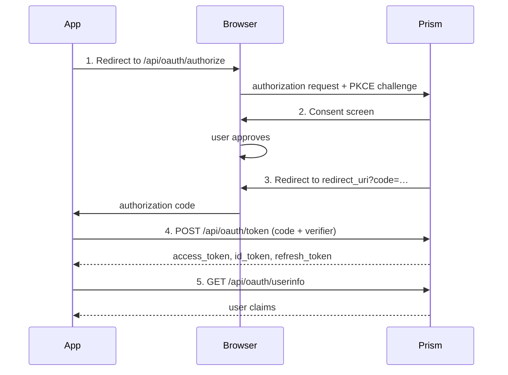

Prism is a standards-compliant OAuth 2.0 authorization server and OpenID Connect provider. Any application that supports the OAuth 2.0 authorization code flow can use Prism as its identity provider.

## Discovery

Prism publishes its metadata at these locations:

```text
https://your-prism-domain/.well-known/openid-configuration       # OpenID Connect Discovery 1.0
https://your-prism-domain/.well-known/oauth-authorization-server # RFC 8414
https://your-prism-domain/.well-known/oauth-protected-resource   # RFC 9728
https://your-prism-domain/.well-known/jwks.json                  # signing keys
```

Most OAuth/OIDC libraries configure themselves from the first or second URL.
WebFinger (`/.well-known/webfinger`) is also supported for finding the issuer
from a user identifier like `acct:alice@your-prism-domain`.

## Registering an application

1. Sign in to Prism and go to **Apps → New Application**.
2. Fill in the name, description, and redirect URIs.
3. Copy the **Client ID** and **Client Secret**. The secret is shown only once.

If your app runs entirely in the browser (nowhere to keep a secret), enable
**Public client**. Public clients must use PKCE and have no client secret.

### Redirect URI matching

Each registered redirect URI has a match type:

| Type       | Behaviour                                                                           |
| ---------- | ----------------------------------------------------------------------------------- |
| `Equals`   | Exact match (default, and the safest).                                              |
| `Wildcard` | `*` stands for any run of characters, e.g. `https://example.com/*`.                 |
| `Regex`    | A regular expression matched against the whole URI, e.g. `https://example\.com/.*`. |

Whatever the type, the URI must use `https:` (or `http:` for loopback hosts) and
must not contain userinfo or a fragment.

If you leave the list empty, the app pins the first redirect URI it is
successfully used with and is locked to it from then on.

::: warning
A `Regex` of `.*` allows **any** redirect URI, including attacker-controlled
ones. Only use it if you understand the risk.
:::

## Authorization code flow (with PKCE)



### Step 1 — Redirect the user

```text
GET https://your-prism-domain/api/oauth/authorize
  ?response_type=code
  &client_id=<CLIENT_ID>
  &redirect_uri=https://yourapp.com/callback
  &scope=openid profile email
  &state=<RANDOM_STATE>
  &code_challenge=<CODE_CHALLENGE>
  &code_challenge_method=S256
```

**PKCE** — generate a `code_verifier` (43–128 random URL-safe characters), then:

```text
code_challenge = BASE64URL(SHA-256(ASCII(code_verifier)))
```

Use `S256`. Prism still accepts `code_challenge_method=plain`, but with `plain`
the challenge is the verifier itself, so anyone who sees the authorization
request URL can redeem a stolen code. An app that uses `plain` gets a warning
on its **OAuth** tab until it has gone 30 days without it.

#### Scopes

| Scope                  | Claims / access granted                               |
| ---------------------- | ----------------------------------------------------- |
| `openid`               | `sub`, `iss`, `aud`, `iat`, `exp` (required for OIDC) |
| `profile`              | `name`, `preferred_username`, `picture`               |
| `profile:write`        | Update the user's profile (name, picture)             |
| `email`                | `email`, `email_verified`                             |
| `apps:read`            | List the apps the user owns                           |
| `apps:write`           | Create, update, and delete the user's apps            |
| `teams:read`           | List the user's teams                                 |
| `teams:write`          | Update team settings and manage members               |
| `teams:create`         | Create teams                                          |
| `teams:delete`         | Delete teams                                          |
| `domains:read`         | List the user's domains                               |
| `domains:write`        | Add and remove domains                                |
| `gpg:read`             | List the user's GPG public keys                       |
| `gpg:write`            | Add and remove GPG public keys                        |
| `social:read`          | List the user's linked social accounts                |
| `social:write`         | Disconnect social accounts                            |
| `admin:users:read`     | Read all user accounts (admin only)                   |
| `admin:users:write`    | Modify user accounts (admin only)                     |
| `admin:users:delete`   | Delete user accounts (admin only)                     |
| `admin:config:read`    | Read instance configuration (admin only)              |
| `admin:config:write`   | Update instance configuration (admin only)            |
| `admin:invites:read`   | List invitations (admin only)                         |
| `admin:invites:create` | Create invitations (admin only)                       |
| `admin:invites:delete` | Delete invitations (admin only)                       |
| `offline_access`       | Issue a refresh token                                 |

Apps can also expose their own scopes to other apps; see
[Cross-App Permissions](app-permissions.md).

#### Team scopes

Three scope families touch teams. Pick the narrowest one that fits.

| Tier           | Example          | Reach                                  | Granted by                               |
| -------------- | ---------------- | -------------------------------------- | ---------------------------------------- |
| Aggregate      | `teams:read`     | Every team the user belongs to         | The user                                 |
| Single-team    | `team:read`      | One team, chosen on the consent screen | An owner, co-owner or admin of that team |
| Cross-instance | `site:team:read` | Every team on the instance             | A site admin, after a 2FA confirmation   |

- **`teams:*`** (`read`, `write`, `create`, `delete`) suits workspace pickers and
  membership sync, and unlocks the [`teams` claim](#id-token).
- **`team:*`** (`read`, `write`, `delete`, `member:read`, `member:write`,
  `member:profile:read`) is bound to the team the user picks: `team:read`
  becomes `team:<team-id>:read` in the issued token, and the token can only act
  on that team. The user must be an owner, co-owner or admin of it (inherited
  roles count), and `team:delete` needs an owner or co-owner. Endpoints are under
  `/api/oauth/me/team/:teamId/...`.
- **`site:team:*`** is for site-administration tools only; anything granted
  there bypasses team owners' consent.

Don't request `teams:*` and `team:*` together; the consent screen would show both
an all-teams notice and a team picker.

#### Site scopes (admin-only)

Cross-instance scopes can only be granted by a site admin, who must confirm with
2FA and type the phrase `grant site access`.

| Scope               | Grants                         |
| ------------------- | ------------------------------ |
| `site:user:read`    | Read every user account        |
| `site:user:write`   | Modify any user                |
| `site:user:delete`  | Delete any user                |
| `site:team:read`    | Read every team                |
| `site:team:write`   | Modify any team                |
| `site:team:delete`  | Disband any team               |
| `site:config:read`  | Read site config               |
| `site:config:write` | Modify site config             |
| `site:token:revoke` | Revoke any user's OAuth tokens |

### Step 2 — User consents

Prism shows a consent screen listing your app and the requested scopes. The user
can **Authorize** once, or **Always authorize** to skip the screen next time the
exact same scopes are requested. If the scopes change, the screen is shown
again. Users manage remembered authorizations under **Connected Apps**.

### Step 3 — Receive the code

Prism redirects to your `redirect_uri`:

```text
https://yourapp.com/callback?code=<AUTH_CODE>&state=<STATE>
```

Always check that `state` matches what you sent.

### Step 4 — Exchange for tokens

```http
POST /api/oauth/token
Content-Type: application/x-www-form-urlencoded

grant_type=authorization_code
&code=<AUTH_CODE>
&redirect_uri=https://yourapp.com/callback
&client_id=<CLIENT_ID>
&client_secret=<CLIENT_SECRET>
&code_verifier=<CODE_VERIFIER>
```

Public clients omit `client_secret` and must include `code_verifier`.

```json
{
  "access_token": "...",
  "token_type": "Bearer",
  "expires_in": 3600,
  "refresh_token": "...",
  "id_token": "...",
  "scope": "openid profile email"
}
```

### Step 5 — Call UserInfo

```http
GET /api/oauth/userinfo
Authorization: Bearer <ACCESS_TOKEN>
```

`GET` and `POST` are both accepted. The token must carry the `openid` scope.

```json
{
  "sub": "user-id",
  "name": "Alice",
  "preferred_username": "alice",
  "email": "alice@example.com",
  "email_verified": true,
  "picture": "https://your-prism-domain/api/assets/avatars/..."
}
```

## Refreshing tokens

```http
POST /api/oauth/token
Content-Type: application/x-www-form-urlencoded

grant_type=refresh_token
&refresh_token=<REFRESH_TOKEN>
&client_id=<CLIENT_ID>
&client_secret=<CLIENT_SECRET>
```

The response carries a **new** `refresh_token`; store it in place of the old one.
Refresh tokens rotate on every use, and presenting an old one revokes the whole
grant. Rotating doesn't extend the original expiry.

When a user replaces their password, or an admin sets it, Prism revokes every
refresh token and access token the user holds, in every app, and sends a
[back-channel logout](#back-channel-logout) to apps that registered one. The
next refresh fails with `invalid_grant`; send the user through authorization
again. JWT access tokens can't be recalled and stay valid until they expire.

## Token introspection (RFC 7662)

For server-to-server checks without parsing JWTs:

```http
POST /api/oauth/introspect
Content-Type: application/x-www-form-urlencoded
Authorization: Basic <base64(client_id:client_secret)>

token=<ACCESS_TOKEN>
```

A client can introspect tokens issued to it. A resource app can also introspect
a token issued to another app when it carries a cross-app scope in that
resource app's namespace (`app:<resource_client_id>:<scope>`). Anything else
returns `{"active": false}`.

```json
{
  "active": true,
  "sub": "user-id",
  "scope": "openid profile",
  "client_id": "...",
  "token_type": "Bearer",
  "exp": 1234567890,
  "iat": 1234564290,
  "aud": ["https://your-prism-domain", "prism_resource_clientid"],
  "iss": "https://your-prism-domain"
}
```

## Token revocation (RFC 7009)

```http
POST /api/oauth/revoke
Content-Type: application/x-www-form-urlencoded

token=<ACCESS_OR_REFRESH_TOKEN>
&client_id=<CLIENT_ID>
&client_secret=<CLIENT_SECRET>
```

Only the calling client's own tokens can be revoked.

## Device Authorization Grant (RFC 8628)

For devices that can't host a browser (CLIs, TVs, IoT).

```http
POST /api/oauth/device_authorization
Content-Type: application/x-www-form-urlencoded

client_id=<CLIENT_ID>
&scope=openid profile
```

```json
{
  "device_code": "…",
  "user_code": "WDJB-MJHT",
  "verification_uri": "https://your-prism-domain/device",
  "verification_uri_complete": "https://your-prism-domain/device?user_code=WDJB-MJHT",
  "expires_in": 600,
  "interval": 5
}
```

Show the user the `verification_uri` and `user_code` (or a QR code of
`verification_uri_complete`), and poll the token endpoint no faster than
`interval` seconds:

```http
POST /api/oauth/token
Content-Type: application/x-www-form-urlencoded

grant_type=urn:ietf:params:oauth:grant-type:device_code
&device_code=<DEVICE_CODE>
&client_id=<CLIENT_ID>
```

Until the user acts you get `authorization_pending` (or `slow_down` if you poll
too fast). `access_denied` and `expired_token` are final. PKCE is optional here.
Site and team scopes can't be granted through the device flow.

## Dynamic Client Registration (RFC 7591 / 7592)

Register a client programmatically with a signed-in user's session token or a
personal access token that has `apps:write`:

```http
POST /api/oauth/register
Authorization: Bearer <SESSION_OR_PAT>
Content-Type: application/json

{
  "client_name": "My CLI",
  "redirect_uris": ["https://app.example.com/callback"],
  "scope": "openid profile email",
  "token_endpoint_auth_method": "client_secret_basic"
}
```

The `201` response includes `client_id`, `client_secret` (confidential clients;
save it, it isn't shown again), a `registration_access_token` and a
`registration_client_uri`. Use that URI with
`Authorization: Bearer <registration_access_token>` to read (`GET`), update
(`PUT`) or deregister (`DELETE`) the client.

For a `private_key_jwt` client, set `token_endpoint_auth_method` to
`private_key_jwt` and include `jwks` or `jwks_uri`. A `jwks_uri` or
`backchannel_logout_uri` must be HTTPS and must not point at a private or
reserved address.

## private_key_jwt client authentication (RFC 7523)

A confidential client can authenticate with a signed assertion instead of a
shared secret. In **App Detail → Settings**, set **Token endpoint auth method**
to `private_key_jwt` and paste a **jwks** or **jwks_uri** (or use DCR). Then, at
the token, PAR, introspection and revocation endpoints, send:

```text
client_assertion_type=urn:ietf:params:oauth:client-assertion-type:jwt-bearer
&client_assertion=<JWT>
```

The assertion is a JWT with `iss` and `sub` set to your `client_id`, `aud` set to
the issuer or token endpoint URL, a short `exp`, and a unique `jti`. Each `jti`
can be used once. Supported algorithms: RS256, ES256, EdDSA.

## DPoP — sender-constrained tokens (RFC 9449)

Bind a token to a key your client holds, so a stolen token is useless without
the key. Send a `DPoP` header (a JWT signed by your key) on the token request:

```http
POST /api/oauth/token
DPoP: <proof-jwt>   # htm=POST, htu=<token endpoint>, iat, jti
Content-Type: application/x-www-form-urlencoded

grant_type=authorization_code&code=...&client_id=...&code_verifier=...
```

The response has `"token_type": "DPoP"`. At a resource, use the `DPoP` scheme
with a fresh proof that also hashes the token (`ath`):

```http
GET /api/oauth/userinfo
Authorization: DPoP <ACCESS_TOKEN>
DPoP: <proof-jwt>   # htm=GET, htu=<resource url>, ath=base64url(sha256(token))
```

A DPoP-bound token sent as plain `Bearer`, or without a matching proof, is
rejected. Refresh requests must repeat the proof with the same key. Supported
algorithms: RS256, ES256, EdDSA. Each proof's `jti` can be used once.

## Token Exchange (RFC 8693)

Exchange one access token for another, for delegation between apps:

```http
POST /api/oauth/token
Authorization: Basic <base64(client_id:client_secret)>
Content-Type: application/x-www-form-urlencoded

grant_type=urn:ietf:params:oauth:grant-type:token-exchange
&subject_token=<ACCESS_TOKEN>
&subject_token_type=urn:ietf:params:oauth:token-type:access_token
&scope=openid profile
&resource=https://api.example.com
```

You can exchange a token issued to your client, or one that carries a cross-app
scope naming it (`app:<client_id>:*`). The new token's scope is a subset of the
original's and its audience follows `resource` / `audience`. Exchanged tokens
can't be refreshed.

## Re-authentication and context (`prompt`, `max_age`, `acr`)

The authorization request honors these OpenID Connect parameters:

- `prompt=none` — no UI. Returns `login_required` if the user must sign in, or
  `consent_required` if consent is missing.
- `prompt=login` — force a fresh sign-in.
- `prompt=consent` — always show the consent screen.
- `max_age=<seconds>` — require a sign-in no older than this.

The ID token then carries `auth_time`, `amr` (e.g. `["pwd","otp","mfa"]`,
`["webauthn"]`) and `acr` (`mfa` when a second factor was used, else `pwd`).

### Step-up authentication (RFC 9470)

Request `acr_values=mfa` on the authorization request and Prism re-authenticates
the user if the session doesn't meet it. Access tokens and introspection
responses carry `acr`, `auth_time` and `amr`, so a resource server can demand
stronger authentication:

```http
HTTP/1.1 401 Unauthorized
WWW-Authenticate: Bearer error="insufficient_user_authentication", acr_values="mfa"
```

The client then repeats authorization with `acr_values=mfa`.

## Pushed Authorization Requests (RFC 9126)

Send the authorization parameters to Prism first and get back a one-time
`request_uri`, so they can't be tampered with in the browser:

```http
POST /api/oauth/par
Content-Type: application/x-www-form-urlencoded
Authorization: Basic <base64(client_id:client_secret)>

response_type=code
&redirect_uri=<REDIRECT_URI>
&scope=openid profile
&code_challenge=<CHALLENGE>&code_challenge_method=S256
&state=<STATE>
```

```json
{ "request_uri": "urn:ietf:params:oauth:request_uri:…", "expires_in": 90 }
```

Then send the user to:

```text
https://your-prism-domain/api/oauth/authorize?client_id=<CLIENT_ID>&request_uri=<REQUEST_URI>
```

## Authorization response `iss` (RFC 9207)

Every authorization response, success or error, carries an `iss` parameter set
to your Prism URL. Clients that check it are protected against mix-up attacks.

## Resource Indicators (RFC 8707)

Add one or more `resource` parameters (absolute URIs, no fragment) to a PAR,
authorization or device-authorization request to name the resource servers the
token is for. Each is added to the token's `aud` and kept across refreshes.

## RP-Initiated Logout

```text
GET /api/oauth/end_session?id_token_hint=<ID_TOKEN>&post_logout_redirect_uri=<URI>&state=<STATE>
```

Ends the user's Prism session. If `post_logout_redirect_uri` exactly matches one
registered on the client (`post_logout_redirect_uris`), the browser is sent
there with `state`; otherwise it lands on Prism's signed-out page.

Send the `id_token_hint` from the user's current sign-in. It identifies the
client. Since any site could link here, Prism signs the user out without
asking only when the hint was issued to them in this browser session (its
`sid`) and they still allow the app. A site admin can limit this to first-party
apps. Otherwise it asks first, and if the user
stays signed in, they go to Prism's home page instead.

## Back-Channel Logout

Register a `backchannel_logout_uri` on your client (App Detail → Settings, DCR,
or the app API). When the user signs out of Prism, Prism POSTs a signed
`logout_token` to it:

```http
POST <backchannel_logout_uri>
Content-Type: application/x-www-form-urlencoded

logout_token=<JWT>
```

The token is an RS256 JWT with `iss`, `aud` (your `client_id`), `sub`, `iat`,
`jti`, `sid` (the session that ended) and the back-channel-logout `events`
claim. Verify it against the JWKS and end the user's session in your app.

## ID token

The ID token is a signed JWT. The default algorithm is **ML-DSA-65**
(post-quantum); **RS256** is also published at `/.well-known/jwks.json` for
legacy clients. Verify it with the keys from the JWKS endpoint, or use
introspection.

Always present when `openid` is requested:

| Claim   | Value                   |
| ------- | ----------------------- |
| `iss`   | Your Prism URL          |
| `sub`   | Stable user ID          |
| `aud`   | Your `client_id`        |
| `iat`   | Issued-at time          |
| `exp`   | Expiry time             |
| `role`  | `user` or `admin`       |
| `nonce` | Echoed from the request |

`profile` and `email` claims are included whenever those scopes are granted.
The rest also need the app to list the field name in its `oidc_fields`:

| Scope          | Field name        | Claim added                                                       |
| -------------- | ----------------- | ----------------------------------------------------------------- |
| `teams:read`   | `teams`           | `teams` — array of `{ id, name, role, groups }`                   |
| `apps:read`    | `apps`            | `apps` — array of `{ id, name, client_id, is_verified }`          |
| `domains:read` | `domains`         | `domains` — array of `{ id, domain, verified }`                   |
| `gpg:read`     | `gpg_keys`        | `gpg_keys` — array of `{ id, fingerprint, key_id, name }`         |
| `social:read`  | `social_accounts` | `social_accounts` — array of `{ id, provider, provider_user_id }` |

Set `oidc_fields` when creating or updating the app, e.g.
`{ "oidc_fields": ["teams", "domains"] }`.

### Flat per-team claims

Granting `teams:read` (or any bound `team:<id>:*` scope) also adds flat claims,
because policy engines like Cloudflare Access can only match flat names:

| Claim                      | Value          | Present when                                                                          |
| -------------------------- | -------------- | ------------------------------------------------------------------------------------- |
| `in_team_<team-id>`        | `true`         | The user is a member of that team                                                     |
| `role_in_team_<team-id>`   | e.g. `admin`   | Alongside `in_team_<team-id>`                                                         |
| `groups_in_team_<team-id>` | array of slugs | The team uses [member groups](teams.md#member-groups) and the user holds at least one |

`groups_in_team_<id>` is left out rather than sent empty. Values are group
_slugs_, which never change, so policies keep working if a group is renamed.

## Step-up 2FA

Apps can ask Prism to have the user re-confirm with TOTP or a passkey before a
sensitive action such as a transfer or deletion. Your server registers the
action with Prism first, then redirects the user, so nobody who only controls a
URL can forge a confirmation page. The user must be signed in to Prism and have
a TOTP authenticator or passkey. No new access is granted; you get a one-time
proof that the user re-confirmed.

### Step 1 — Create a challenge (server-to-server)

```http
POST /api/oauth/2fa/challenges
Authorization: Basic <base64(client_id:client_secret)>
Content-Type: application/json

{
  "redirect_uri": "https://app.example.com/2fa-callback",
  "action": "Confirm wire transfer of $1,000",
  "nonce": "order_abc123",
  "code_challenge": "PKCE_CHALLENGE",
  "code_challenge_method": "S256"
}
```

| Field                                     | Required                    | Description                                                                          |
| ----------------------------------------- | --------------------------- | ------------------------------------------------------------------------------------ |
| `client_id`                               | yes (Basic or body)         | Your app's client ID                                                                 |
| `client_secret`                           | confidential clients        | In Basic auth or the body. `private_key_jwt` clients send `client_assertion` instead |
| `redirect_uri`                            | yes                         | Must be registered on the app                                                        |
| `action`                                  | recommended                 | Description (≤ 200 chars) of what the user is confirming, shown verbatim             |
| `nonce`                                   | optional                    | Opaque value (≤ 256 chars) echoed back; bind it to the operation (e.g. an order ID)  |
| `require_captcha`                         | optional                    | Ask for a captcha on this confirmation                                               |
| `code_challenge`, `code_challenge_method` | required for public clients | PKCE                                                                                 |

```json
{
  "challenge_id": "f3a…opaque…",
  "expires_at": 1761500900,
  "url": "https://prism.example.com/oauth/2fa?challenge_id=f3a…"
}
```

Challenge creation is limited to 60 per minute per client.

### Step 2 — Redirect the user

```text
https://prism.example.com/oauth/2fa?challenge_id=f3a…&state=RANDOM
```

### Step 3 — User confirms

Prism shows your app's icon, a verified badge if applicable, the `action` text,
and asks for TOTP or a passkey. The user must tick a box acknowledging the
action before **Confirm** is enabled.

### Step 4 — Receive the code

The user returns to your pinned `redirect_uri`:

```text
https://app.example.com/2fa-callback?code=…&state=…
```

or, if they denied it or something failed:

```text
https://app.example.com/2fa-callback?error=access_denied&state=…
```

### Step 5 — Verify (server-side)

```http
POST /api/oauth/2fa/verify
Content-Type: application/x-www-form-urlencoded

code=THE_CODE&client_id=YOUR_CLIENT_ID&redirect_uri=…&code_verifier=PKCE_VERIFIER
```

Confidential clients also send `client_secret` (body or Basic) or a
`client_assertion`. Public clients use PKCE only.

```json
{
  "user_id": "u_abc",
  "client_id": "YOUR_CLIENT_ID",
  "verified_at": 1761500000,
  "action": "Confirm wire transfer of $1,000",
  "nonce": "order_abc123",
  "method": "totp"
}
```

The code works once and expires after 5 minutes. Check that `nonce` and `action`
match what you stored when you built the URL, and that `verified_at` is recent
enough for you. `method` is `totp`, `passkey`, `backup` or `sudo`.

### Captcha

A captcha can be required for every step-up (the site setting), or by your app
for a particular challenge (`require_captcha: true`). Your app can't switch off
a site-wide requirement. It does nothing if the site has no captcha configured.

### Sudo mode

After a successful confirmation, the user can opt into a grace window during
which further challenges from the same app in the same Prism session skip the
TOTP/passkey prompt. The action checkbox is still required. The length is set by
the site admin (`0` disables it), and the window applies only to that user,
session and app. Those confirmations come back with `method: "sudo"`; **for very
high-stakes actions, require `method !== "sudo"`** so a fresh prompt is always
shown.

Users can end a window early:

```http
POST /api/oauth/2fa/sudo/revoke
Authorization: Bearer <user-session-jwt>
Content-Type: application/json

{ "client_id": "YOUR_CLIENT_ID" }
```

### Security notes

- The action text and redirect URI are fixed at step 1, which needs your app's
  credentials, so a phishing URL can't change them.
- The code is bound to your `client_id` and `redirect_uri`, and PKCE binds it to
  your verifier.
- TOTP attempts are rate-limited, and a failed attempt uses up the challenge.
- This can't protect against a fully compromised device, or against someone who
  holds your `client_secret`. Rotate secrets if you suspect a leak.

## Error responses

Authorization errors redirect to your `redirect_uri` with:

```text
?error=access_denied&error_description=User+denied+access
```

Token endpoint errors return HTTP 400:

```json
{ "error": "invalid_grant", "error_description": "Code expired or invalid" }
```

Common codes: `invalid_request`, `invalid_client`, `invalid_grant`,
`unauthorized_client`, `unsupported_grant_type`, `access_denied`.

## Integrations

### Cloudflare Access

You can use Prism as a generic OIDC identity provider for
[Cloudflare Access](https://developers.cloudflare.com/cloudflare-one/identity/idp-integration/generic-oidc/),
so users sign in to Cloudflare-protected resources with their Prism account.

#### Step 1 — Create an OAuth app in Prism

1. Go to **Apps → New Application**.
2. Set the redirect URI to:

   ```text
   https://<your-team-name>.cloudflareaccess.com/cdn-cgi/access/callback
   ```

3. Set **Allowed scopes** to include at least `openid` and `email`, plus
   `profile` and `teams:read` if you want those claims in policies.
4. Set **OIDC fields** to the custom claims to embed, e.g. `["role", "teams"]`.
5. Copy the **Client ID** and **Client Secret**.

#### Step 2 — Add Prism as an identity provider in Cloudflare

In [Cloudflare Zero Trust](https://one.dash.cloudflare.com/), go to
**Integrations → Identity providers → Add new → OpenID Connect**:

| Field           | Value                                                    |
| --------------- | -------------------------------------------------------- |
| Name            | Prism (or any label)                                     |
| App ID          | Your Prism **Client ID**                                 |
| Client secret   | Your Prism **Client Secret**                             |
| Auth URL        | `https://your-prism-domain/api/oauth/authorize`          |
| Token URL       | `https://your-prism-domain/api/oauth/token`              |
| Certificate URL | `https://your-prism-domain/.well-known/jwks.json`        |
| PKCE            | Enabled (recommended)                                    |
| Scopes          | `openid email` (add `profile teams:read` etc. as needed) |
| OIDC Claims     | One per line — the claim names you want in policies      |

For example, under **OIDC Claims**:

```text
role
in_team_<team-id>
role_in_team_<team-id>
groups_in_team_<team-id>
```

Use **Test** to check. A successful test shows the claims under `oidc_fields`:

```json
{
  "email": "alice@example.com",
  "oidc_fields": {
    "role": "admin",
    "in_team_abc123": true,
    "role_in_team_abc123": "owner",
    "groups_in_team_abc123": ["backend", "oncall"]
  }
}
```

#### Step 3 — Build Access policies

In your Access policy, use the **OIDC Claim** selector:

| Claim name                 | Claim value | Effect                     |
| -------------------------- | ----------- | -------------------------- |
| `role`                     | `admin`     | Prism admins only          |
| `in_team_<team-id>`        | `true`      | Members of a specific team |
| `role_in_team_<team-id>`   | `owner`     | Team owners only           |
| `groups_in_team_<team-id>` | `oncall`    | Members holding that group |

> **Note:** Access reads custom claims from the ID token, and the names under
> OIDC Claims must exactly match what Prism embeds, which the app's
> `oidc_fields` setting controls.

> **Array claims:** `groups_in_team_<team-id>` is an array. Access matches it
> through its [multi-record OIDC claims](https://developers.cloudflare.com/cloudflare-one/integrations/identity-providers/generic-oidc/#multi-record-oidc-claims)
> support, so a policy value of `oncall` matches any user whose array contains
> `oncall`. Access only matches whole values, which is why the claim carries
> group slugs rather than display names.
