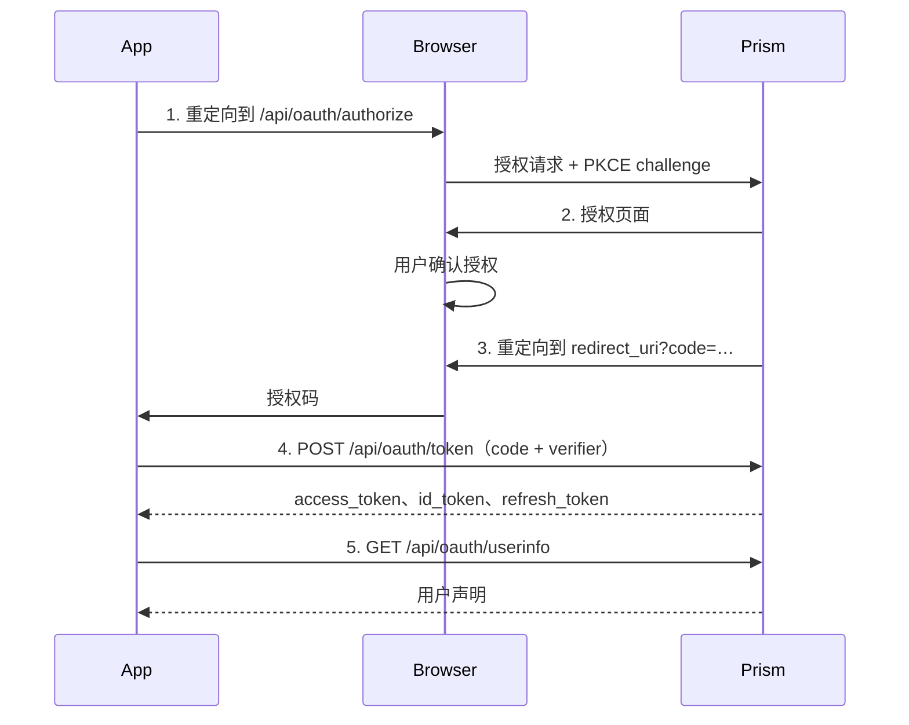

Prism 是一个符合标准的 OAuth 2.0 授权服务器和 OpenID Connect 提供商。任何支持 OAuth 2.0 授权码流程的应用都可以使用 Prism 作为其身份提供商。

## Discovery

Prism 在以下位置发布元数据：

```text
https://your-prism-domain/.well-known/openid-configuration       # OpenID Connect Discovery 1.0
https://your-prism-domain/.well-known/oauth-authorization-server # RFC 8414
https://your-prism-domain/.well-known/oauth-protected-resource   # RFC 9728
https://your-prism-domain/.well-known/jwks.json                  # signing keys
```

大多数 OAuth/OIDC 库会从第一个或第二个 URL 自动完成配置。同时也支持 WebFinger（`/.well-known/webfinger`），可用 `acct:alice@your-prism-domain` 这类用户标识符查找 issuer。

## 注册应用

1. 登录 Prism，前往 **我的应用 → 新建应用**。
2. 填写名称、描述和重定向 URI。
3. 复制 **Client ID** 和 **Client Secret**。密钥仅显示一次。

如果你的应用完全运行在浏览器中（没有地方保存密钥），请启用**公共客户端**。公共客户端必须使用 PKCE，且没有客户端密钥。

### 重定向 URI 匹配

每个注册的重定向 URI 都有一个匹配类型：

| 类型       | 行为                                                          |
| ---------- | ------------------------------------------------------------- |
| `Equals`   | 精确匹配（默认，也是最安全的方式）。                          |
| `Wildcard` | `*` 代表任意长度的字符，例如 `https://example.com/*`。        |
| `Regex`    | 与整个 URI 匹配的正则表达式，例如 `https://example\.com/.*`。 |

无论哪种类型，URI 都必须使用 `https:`（loopback 主机可用 `http:`），且不得包含 userinfo 或 fragment。

如果将列表留空，应用会固定使用第一个成功使用的重定向 URI，此后锁定为该值。

::: warning
`.*` 的 `Regex` 会允许**任意**重定向 URI，包括攻击者控制的地址。请仅在理解风险的情况下使用。
:::

## 授权码流程（含 PKCE）



### 第一步 — 重定向用户

```text
GET https://your-prism-domain/api/oauth/authorize
  ?response_type=code
  &client_id=<CLIENT_ID>
  &redirect_uri=https://yourapp.com/callback
  &scope=openid profile email
  &state=<RANDOM_STATE>
  &code_challenge=<CODE_CHALLENGE>
  &code_challenge_method=S256
```

**PKCE** — 生成一个 `code_verifier`（43–128 个随机 URL 安全字符），然后：

```text
code_challenge = BASE64URL(SHA-256(ASCII(code_verifier)))
```

#### 权限范围

| 范围                   | 包含的声明 / 授予的访问                        |
| ---------------------- | ---------------------------------------------- |
| `openid`               | `sub`、`iss`、`aud`、`iat`、`exp`（OIDC 必须） |
| `profile`              | `name`、`preferred_username`、`picture`        |
| `profile:write`        | 更新用户的个人资料（名称、头像）               |
| `email`                | `email`、`email_verified`                      |
| `apps:read`            | 列出用户拥有的应用                             |
| `apps:write`           | 创建、更新和删除用户的应用                     |
| `teams:read`           | 列出用户的团队                                 |
| `teams:write`          | 更新团队设置并管理成员                         |
| `teams:create`         | 创建团队                                       |
| `teams:delete`         | 删除团队                                       |
| `domains:read`         | 列出用户的域名                                 |
| `domains:write`        | 添加和删除域名                                 |
| `gpg:read`             | 列出用户的 GPG 公钥                            |
| `gpg:write`            | 添加和删除 GPG 公钥                            |
| `social:read`          | 列出用户已关联的社交账号                       |
| `social:write`         | 断开社交账号关联                               |
| `admin:users:read`     | 读取所有用户账号（仅限管理员）                 |
| `admin:users:write`    | 修改用户账号（仅限管理员）                     |
| `admin:users:delete`   | 删除用户账号（仅限管理员）                     |
| `admin:config:read`    | 读取实例配置（仅限管理员）                     |
| `admin:config:write`   | 更新实例配置（仅限管理员）                     |
| `admin:invites:read`   | 列出邀请（仅限管理员）                         |
| `admin:invites:create` | 创建邀请（仅限管理员）                         |
| `admin:invites:delete` | 删除邀请（仅限管理员）                         |
| `offline_access`       | 签发刷新令牌                                   |

应用也可以向其他应用暴露自己的 scope；参见[跨应用权限](app-permissions.md)。

#### 团队 scope

涉及团队的 scope 共分三类，请选择最窄的一类。

| 层级   | 示例             | 访问范围                   | 授予方式                           |
| ------ | ---------------- | -------------------------- | ---------------------------------- |
| 聚合   | `teams:read`     | 用户所属的每个团队         | 用户本人                           |
| 单团队 | `team:read`      | 在授权页面上选定的一个团队 | 该团队的所有者、共同所有者或管理员 |
| 跨实例 | `site:team:read` | 实例上的每个团队           | 站点管理员，且需通过 2FA 确认      |

- **`teams:*`**（`read`、`write`、`create`、`delete`）适合作工作区选择器和成员关系同步，并会生成 [`teams` claim](#id-令牌)。
- **`team:*`**（`read`、`write`、`delete`、`member:read`、`member:write`、`member:profile:read`）绑定到用户选定的团队：`team:read` 在签发的令牌中变为 `team:<team-id>:read`，该令牌只能作用于这一个团队。用户必须是该团队的所有者、共同所有者或管理员（继承的角色同样算数），`team:delete` 还需要所有者或共同所有者。端点位于 `/api/oauth/me/team/:teamId/...`。
- **`site:team:*`** 仅用于站点管理工具；此处授予的任何权限都会绕过团队所有者的授权。

不要同时请求 `teams:*` 和 `team:*`；否则授权页面会同时显示全团队提示和团队选择器。

#### 站点 scope

跨实例 scope 只能由站点管理员授予，且必须通过 2FA 确认并输入短语 `grant site access`。

| Scope               | 授予的权限                |
| ------------------- | ------------------------- |
| `site:user:read`    | 读取每个用户账号          |
| `site:user:write`   | 修改任意用户              |
| `site:user:delete`  | 删除任意用户              |
| `site:team:read`    | 读取每个团队              |
| `site:team:write`   | 修改任意团队              |
| `site:team:delete`  | 解散任意团队              |
| `site:config:read`  | 读取站点配置              |
| `site:config:write` | 修改站点配置              |
| `site:token:revoke` | 撤销任意用户的 OAuth 令牌 |

### 第二步 — 用户授权

Prism 会显示授权页面，列出你的应用和请求的权限范围。用户可以选择**授权**一次，或选择**始终授权**，在下次请求完全相同的权限范围时跳过该页面。如果权限范围发生变化，页面会再次显示。用户可在**已授权应用**中管理已记住的授权。

### 第三步 — 接收授权码

Prism 重定向到你的 `redirect_uri`：

```text
https://yourapp.com/callback?code=<AUTH_CODE>&state=<STATE>
```

务必校验 `state` 与你发送的值一致。

### 第四步 — 换取令牌

```http
POST /api/oauth/token
Content-Type: application/x-www-form-urlencoded

grant_type=authorization_code
&code=<AUTH_CODE>
&redirect_uri=https://yourapp.com/callback
&client_id=<CLIENT_ID>
&client_secret=<CLIENT_SECRET>
&code_verifier=<CODE_VERIFIER>
```

公共客户端省略 `client_secret`，并且必须包含 `code_verifier`。

```json
{
  "access_token": "...",
  "token_type": "Bearer",
  "expires_in": 3600,
  "refresh_token": "...",
  "id_token": "...",
  "scope": "openid profile email"
}
```

### 第五步 — 调用 UserInfo

```http
GET /api/oauth/userinfo
Authorization: Bearer <ACCESS_TOKEN>
```

`GET` 和 `POST` 均被接受。令牌必须携带 `openid` 权限范围。

```json
{
  "sub": "user-id",
  "name": "Alice",
  "preferred_username": "alice",
  "email": "alice@example.com",
  "email_verified": true,
  "picture": "https://your-prism-domain/api/assets/avatars/..."
}
```

## 刷新令牌

```http
POST /api/oauth/token
Content-Type: application/x-www-form-urlencoded

grant_type=refresh_token
&refresh_token=<REFRESH_TOKEN>
&client_id=<CLIENT_ID>
&client_secret=<CLIENT_SECRET>
```

响应中会返回**新的** `refresh_token`，请用它替换旧的令牌。刷新令牌每次使用后都会轮换，出示旧令牌会撤销整个授权。轮换不会延长原有的过期时间。

## 令牌内省（RFC 7662）

用于服务端之间的校验，无需解析 JWT：

```http
POST /api/oauth/introspect
Content-Type: application/x-www-form-urlencoded
Authorization: Basic <base64(client_id:client_secret)>

token=<ACCESS_TOKEN>
```

客户端可以内省签发给自己的令牌。资源应用也可以内省签发给其他应用的令牌，前提是该令牌携带了位于该资源应用命名空间中的跨应用 scope（`app:<resource_client_id>:<scope>`）。其他情况一律返回 `{"active": false}`。

```json
{
  "active": true,
  "sub": "user-id",
  "scope": "openid profile",
  "client_id": "...",
  "token_type": "Bearer",
  "exp": 1234567890,
  "iat": 1234564290,
  "aud": ["https://your-prism-domain", "prism_resource_clientid"],
  "iss": "https://your-prism-domain"
}
```

## 令牌撤销（RFC 7009）

```http
POST /api/oauth/revoke
Content-Type: application/x-www-form-urlencoded

token=<ACCESS_OR_REFRESH_TOKEN>
&client_id=<CLIENT_ID>
&client_secret=<CLIENT_SECRET>
```

只能撤销调用方客户端自己的令牌。

## 设备授权（RFC 8628）

适用于无法承载浏览器的设备（CLI、电视、IoT）。

```http
POST /api/oauth/device_authorization
Content-Type: application/x-www-form-urlencoded

client_id=<CLIENT_ID>
&scope=openid profile
```

```json
{
  "device_code": "…",
  "user_code": "WDJB-MJHT",
  "verification_uri": "https://your-prism-domain/device",
  "verification_uri_complete": "https://your-prism-domain/device?user_code=WDJB-MJHT",
  "expires_in": 600,
  "interval": 5
}
```

向用户展示 `verification_uri` 和 `user_code`（或 `verification_uri_complete` 的二维码），并以不快于 `interval` 秒的频率轮询令牌端点：

```http
POST /api/oauth/token
Content-Type: application/x-www-form-urlencoded

grant_type=urn:ietf:params:oauth:grant-type:device_code
&device_code=<DEVICE_CODE>
&client_id=<CLIENT_ID>
```

在用户操作之前会返回 `authorization_pending`（轮询过快则返回 `slow_down`）。`access_denied` 和 `expired_token` 为终止状态。此处 PKCE 为可选。站点和团队 scope 无法通过设备流授予。

## 动态客户端注册（RFC 7591 / 7592）

使用已登录用户的会话令牌，或带 `apps:write` 的个人访问令牌，以编程方式注册客户端：

```http
POST /api/oauth/register
Authorization: Bearer <SESSION_OR_PAT>
Content-Type: application/json

{
  "client_name": "My CLI",
  "redirect_uris": ["https://app.example.com/callback"],
  "scope": "openid profile email",
  "token_endpoint_auth_method": "client_secret_basic"
}
```

`201` 响应包含 `client_id`、`client_secret`（机密客户端；请保存，之后不再显示）、`registration_access_token` 和 `registration_client_uri`。使用该 URI 并携带 `Authorization: Bearer <registration_access_token>` 即可读取（`GET`）、更新（`PUT`）或注销（`DELETE`）该客户端。

对于 `private_key_jwt` 客户端，将 `token_endpoint_auth_method` 设为 `private_key_jwt`，并提供 `jwks` 或 `jwks_uri`。`jwks_uri` 或 `backchannel_logout_uri` 必须使用 HTTPS，且不得指向私有或保留地址。

## private_key_jwt 客户端认证（RFC 7523）

机密客户端可以使用签名断言代替共享密钥进行认证。在**应用详情 → 设置**中，将**令牌端点认证方式**设为 `private_key_jwt`，并填入 **jwks** 或 **jwks_uri**（或使用 DCR）。然后在令牌、PAR、内省和撤销端点上发送：

```text
client_assertion_type=urn:ietf:params:oauth:client-assertion-type:jwt-bearer
&client_assertion=<JWT>
```

该断言是一个 JWT，其 `iss` 和 `sub` 设为你的 `client_id`，`aud` 设为 issuer 或令牌端点 URL，`exp` 较短，`jti` 唯一。每个 `jti` 只能使用一次。支持的算法：RS256、ES256、EdDSA。

## DPoP — 发送方约束的令牌（RFC 9449）

将令牌绑定到客户端持有的密钥上，这样即使令牌被窃取，没有密钥也无法使用。在令牌请求上发送 `DPoP` 头（由你的密钥签名的 JWT）：

```http
POST /api/oauth/token
DPoP: <proof-jwt>   # htm=POST, htu=<token endpoint>, iat, jti
Content-Type: application/x-www-form-urlencoded

grant_type=authorization_code&code=...&client_id=...&code_verifier=...
```

响应中带有 `"token_type": "DPoP"`。在资源端，使用 `DPoP` scheme 并附上一个同时对令牌做哈希（`ath`）的新证明：

```http
GET /api/oauth/userinfo
Authorization: DPoP <ACCESS_TOKEN>
DPoP: <proof-jwt>   # htm=GET, htu=<resource url>, ath=base64url(sha256(token))
```

以普通 `Bearer` 出示 DPoP 绑定的令牌，或缺少匹配证明，都会被拒绝。刷新请求必须使用同一密钥重复该证明。支持的算法：RS256、ES256、EdDSA。每个证明的 `jti` 只能使用一次。

## 令牌交换（RFC 8693）

用一个访问令牌换取另一个，用于应用之间的委托：

```http
POST /api/oauth/token
Authorization: Basic <base64(client_id:client_secret)>
Content-Type: application/x-www-form-urlencoded

grant_type=urn:ietf:params:oauth:grant-type:token-exchange
&subject_token=<ACCESS_TOKEN>
&subject_token_type=urn:ietf:params:oauth:token-type:access_token
&scope=openid profile
&resource=https://api.example.com
```

你可以交换签发给你的客户端的令牌，或携带指向它的跨应用 scope（`app:<client_id>:*`）的令牌。新令牌的 scope 是原令牌的子集，其受众遵循 `resource` / `audience`。交换得到的令牌不可刷新。

## 重新认证与上下文（`prompt`、`max_age`、`acr`）

授权请求遵循以下 OpenID Connect 参数：

- `prompt=none` — 不显示界面。如果用户需要登录则返回 `login_required`，如果缺少授权则返回 `consent_required`。
- `prompt=login` — 强制重新登录。
- `prompt=consent` — 始终显示授权页面。
- `max_age=<秒>` — 要求登录时间不早于该时长。

ID 令牌随后携带 `auth_time`、`amr`（例如 `["pwd","otp","mfa"]`、`["webauthn"]`）和 `acr`（使用了第二因子时为 `mfa`，否则为 `pwd`）。

### 提升认证（RFC 9470）

在授权请求中请求 `acr_values=mfa`，如果会话不满足要求，Prism 会重新认证用户。访问令牌和内省响应携带 `acr`、`auth_time` 和 `amr`，因此资源服务器可以要求更强的认证：

```http
HTTP/1.1 401 Unauthorized
WWW-Authenticate: Bearer error="insufficient_user_authentication", acr_values="mfa"
```

客户端随后带 `acr_values=mfa` 重新发起授权。

## 推送式授权请求（RFC 9126）

先把授权参数发送给 Prism，换取一次性的 `request_uri`，这样它们就无法在浏览器中被篡改：

```http
POST /api/oauth/par
Content-Type: application/x-www-form-urlencoded
Authorization: Basic <base64(client_id:client_secret)>

response_type=code
&redirect_uri=<REDIRECT_URI>
&scope=openid profile
&code_challenge=<CHALLENGE>&code_challenge_method=S256
&state=<STATE>
```

```json
{ "request_uri": "urn:ietf:params:oauth:request_uri:…", "expires_in": 90 }
```

然后将用户发送到：

```text
https://your-prism-domain/api/oauth/authorize?client_id=<CLIENT_ID>&request_uri=<REQUEST_URI>
```

## 授权响应 `iss`（RFC 9207）

每个授权响应（无论成功还是错误）都携带 `iss` 参数，值为你的 Prism URL。校验它的客户端可以抵御混淆（mix-up）攻击。

## 资源指示符（RFC 8707）

在 PAR、授权或设备授权请求中加入一个或多个 `resource` 参数（绝对 URI，不含 fragment），指明令牌面向的资源服务器。每个值都会加入令牌的 `aud`，并在刷新时保留。

## RP 发起的登出

```text
GET /api/oauth/end_session?id_token_hint=<ID_TOKEN>&post_logout_redirect_uri=<URI>&state=<STATE>
```

结束用户的 Prism 会话。如果 `post_logout_redirect_uri` 与客户端注册的某一项（`post_logout_redirect_uris`）完全匹配，浏览器会带 `state` 跳转到该地址；否则落到 Prism 的已登出页面。`id_token_hint` 用于标识客户端，建议提供。

## 后端通道登出

在客户端上注册 `backchannel_logout_uri`（应用详情 → 设置、DCR 或应用 API）。当用户从 Prism 登出时，Prism 会向其 POST 一个签名的 `logout_token`：

```http
POST <backchannel_logout_uri>
Content-Type: application/x-www-form-urlencoded

logout_token=<JWT>
```

该令牌是一个 RS256 JWT，包含 `iss`、`aud`（你的 `client_id`）、`sub`、`iat`、`jti`、`sid`（已结束的会话）以及后端通道登出的 `events` 声明。请对照 JWKS 验证它，并在你的应用中结束用户会话。

## ID 令牌

ID 令牌是一个签名的 JWT。默认算法为 **ML-DSA-65**（后量子）；`/.well-known/jwks.json` 同时也发布 **RS256** 以兼容旧客户端。请使用 JWKS 端点发布的密钥验证它，或使用内省。

请求了 `openid` 时始终包含：

| 声明    | 值                |
| ------- | ----------------- |
| `iss`   | 你的 Prism URL    |
| `sub`   | 稳定的用户 ID     |
| `aud`   | 你的 `client_id`  |
| `iat`   | 签发时间          |
| `exp`   | 过期时间          |
| `role`  | `user` 或 `admin` |
| `nonce` | 从请求中原样返回  |

只要授予了对应权限范围，就会包含 `profile` 和 `email` 声明。其余声明还需要应用在其 `oidc_fields` 中列出字段名：

| 权限范围       | 字段名            | 添加的声明                                                    |
| -------------- | ----------------- | ------------------------------------------------------------- |
| `teams:read`   | `teams`           | `teams` — `{ id, name, role, groups }` 数组                   |
| `apps:read`    | `apps`            | `apps` — `{ id, name, client_id, is_verified }` 数组          |
| `domains:read` | `domains`         | `domains` — `{ id, domain, verified }` 数组                   |
| `gpg:read`     | `gpg_keys`        | `gpg_keys` — `{ id, fingerprint, key_id, name }` 数组         |
| `social:read`  | `social_accounts` | `social_accounts` — `{ id, provider, provider_user_id }` 数组 |

在创建或更新应用时设置 `oidc_fields`，例如 `{ "oidc_fields": ["teams", "domains"] }`。

### 按团队的扁平 claim

授予 `teams:read`（或任何绑定的 `team:<id>:*` scope）还会添加扁平声明，因为像 Cloudflare Access 这样的策略引擎只能匹配扁平名称：

| Claim                      | 值         | 何时产出                                                    |
| -------------------------- | ---------- | ----------------------------------------------------------- |
| `in_team_<team-id>`        | `true`     | 用户是该团队的成员                                          |
| `role_in_team_<team-id>`   | 如 `admin` | 与 `in_team_<team-id>` 一同产出                             |
| `groups_in_team_<team-id>` | slug 数组  | 该团队使用了[身份组](teams.md#身份组)且用户至少持有其中一个 |

`groups_in_team_<id>` 在为空时会被省略，而不是发送空数组。值是身份组的 _slug_，slug 永不改变，因此即使身份组被重命名，策略依然有效。

## 加强 2FA

应用可以要求用户在执行转账、删除等敏感操作前，通过 TOTP 或 Passkey 再次确认。你的服务器先向 Prism 注册该操作，然后重定向用户，这样仅控制一个 URL 的人无法伪造确认页面。用户必须已登录 Prism，并拥有 TOTP 认证器或 Passkey。此过程不会授予任何新的访问权限；你得到的只是用户已再次确认的一次性证明。

### 第一步 — 创建挑战（服务端到服务端）

```http
POST /api/oauth/2fa/challenges
Authorization: Basic <base64(client_id:client_secret)>
Content-Type: application/json

{
  "redirect_uri": "https://app.example.com/2fa-callback",
  "action": "Confirm wire transfer of $1,000",
  "nonce": "order_abc123",
  "code_challenge": "PKCE_CHALLENGE",
  "code_challenge_method": "S256"
}
```

| 字段                                      | 是否必填               | 说明                                                                         |
| ----------------------------------------- | ---------------------- | ---------------------------------------------------------------------------- |
| `client_id`                               | 必填（Basic 或请求体） | 你的应用的 client ID                                                         |
| `client_secret`                           | 机密客户端必填         | 通过 Basic 或请求体提供。`private_key_jwt` 客户端改为发送 `client_assertion` |
| `redirect_uri`                            | 必填                   | 必须已在应用上注册                                                           |
| `action`                                  | 推荐                   | 用户正在确认的内容描述（≤ 200 字符），原样展示                               |
| `nonce`                                   | 可选                   | 原样回传的不透明值（≤ 256 字符）；建议绑定到具体操作（如订单 ID）            |
| `require_captcha`                         | 可选                   | 在本次确认中要求验证码                                                       |
| `code_challenge`, `code_challenge_method` | 公共客户端必填         | PKCE                                                                         |

```json
{
  "challenge_id": "f3a…opaque…",
  "expires_at": 1761500900,
  "url": "https://prism.example.com/oauth/2fa?challenge_id=f3a…"
}
```

每个客户端每分钟最多创建 60 个挑战。

### 第二步 — 重定向用户

```text
https://prism.example.com/oauth/2fa?challenge_id=f3a…&state=RANDOM
```

### 第三步 — 用户确认

Prism 会展示你的应用图标、（如适用的）已验证徽章、`action` 文案，并要求输入 TOTP 或使用 Passkey。用户必须勾选一个确认该操作的复选框，**确认**按钮才会启用。

### 第四步 — 接收 code

用户回到你固定的 `redirect_uri`：

```text
https://app.example.com/2fa-callback?code=…&state=…
```

或者，如果用户拒绝或发生错误：

```text
https://app.example.com/2fa-callback?error=access_denied&state=…
```

### 第五步 — 校验（服务端）

```http
POST /api/oauth/2fa/verify
Content-Type: application/x-www-form-urlencoded

code=THE_CODE&client_id=YOUR_CLIENT_ID&redirect_uri=…&code_verifier=PKCE_VERIFIER
```

机密客户端还需发送 `client_secret`（请求体或 Basic）或 `client_assertion`。公共客户端仅使用 PKCE。

```json
{
  "user_id": "u_abc",
  "client_id": "YOUR_CLIENT_ID",
  "verified_at": 1761500000,
  "action": "Confirm wire transfer of $1,000",
  "nonce": "order_abc123",
  "method": "totp"
}
```

code 只能使用一次，5 分钟后过期。请校验 `nonce` 和 `action` 与你构造 URL 时存储的值一致，并确认 `verified_at` 对你而言足够新。`method` 为 `totp`、`passkey`、`backup` 或 `sudo`。

### 验证码

可以要求每次加强 2FA 都通过验证码（站点设置），或由你的应用为某次挑战开启（`require_captcha: true`）。你的应用无法关闭站点级别的强制要求。如果站点未配置验证码，则此项不起作用。

### Sudo 模式

确认成功后，用户可以选择开启一个宽限窗口，在此期间同一 Prism 会话中来自同一应用的后续挑战会跳过 TOTP/Passkey 提示。操作复选框仍然必须勾选。窗口时长由站点管理员设置（`0` 表示禁用），仅对该用户、该会话和该应用生效。这些确认返回时 `method` 为 `"sudo"`；**对于风险极高的操作，应要求 `method !== "sudo"`**，以确保始终显示全新的提示。

用户可以提前结束窗口：

```http
POST /api/oauth/2fa/sudo/revoke
Authorization: Bearer <user-session-jwt>
Content-Type: application/json

{ "client_id": "YOUR_CLIENT_ID" }
```

### 安全说明

- 操作文案和重定向 URI 在第一步就已固定，而这一步需要你的应用凭据，因此钓鱼 URL 无法修改它们。
- code 绑定到你的 `client_id` 和 `redirect_uri`，PKCE 又将它绑定到你的 verifier。
- TOTP 尝试有速率限制，一次失败就会消耗掉当前挑战。
- 这无法防御完全失陷的设备，也无法防御持有你 `client_secret` 的人。若怀疑泄露，请轮换密钥。

## 错误响应

授权错误会重定向到你的 `redirect_uri`，附带：

```text
?error=access_denied&error_description=User+denied+access
```

令牌端点错误返回 HTTP 400：

```json
{ "error": "invalid_grant", "error_description": "Code expired or invalid" }
```

常见错误码：`invalid_request`、`invalid_client`、`invalid_grant`、`unauthorized_client`、`unsupported_grant_type`、`access_denied`。

## 集成

### Cloudflare Access

你可以将 Prism 作为 [Cloudflare Access](https://developers.cloudflare.com/cloudflare-one/identity/idp-integration/generic-oidc/) 的通用 OIDC 身份提供商，让用户使用其 Prism 账号登录受 Cloudflare 保护的资源。

#### 第一步 — 在 Prism 中创建 OAuth 应用

1. 前往 **我的应用 → 新建应用**。
2. 将重定向 URI 设置为：

   ```text
   https://<your-team-name>.cloudflareaccess.com/cdn-cgi/access/callback
   ```

3. 将 **Allowed scopes** 设置为至少包含 `openid` 和 `email`；如果希望在策略中使用 `profile` 和 `teams:read` 声明，也一并添加。
4. 将 **OIDC fields** 设置为需要嵌入的自定义声明，例如 `["role", "teams"]`。
5. 复制 **Client ID** 和 **Client Secret**。

#### 第二步 — 在 Cloudflare 中添加 Prism 为身份提供商

在 [Cloudflare Zero Trust](https://one.dash.cloudflare.com/) 中，前往 **Integrations → Identity providers → Add new → OpenID Connect**：

| 字段            | 值                                                 |
| --------------- | -------------------------------------------------- |
| Name            | Prism（或任意名称）                                |
| App ID          | 你的 Prism **Client ID**                           |
| Client secret   | 你的 Prism **Client Secret**                       |
| Auth URL        | `https://your-prism-domain/api/oauth/authorize`    |
| Token URL       | `https://your-prism-domain/api/oauth/token`        |
| Certificate URL | `https://your-prism-domain/.well-known/jwks.json`  |
| PKCE            | 启用（推荐）                                       |
| Scopes          | `openid email`（按需添加 `profile teams:read` 等） |
| OIDC Claims     | 每行一个——你希望在策略中使用的声明名               |

例如，在 **OIDC Claims** 中填写：

```text
role
in_team_<team-id>
role_in_team_<team-id>
groups_in_team_<team-id>
```

使用 **Test** 进行检查。测试成功时会在 `oidc_fields` 下显示这些声明：

```json
{
  "email": "alice@example.com",
  "oidc_fields": {
    "role": "admin",
    "in_team_abc123": true,
    "role_in_team_abc123": "owner",
    "groups_in_team_abc123": ["backend", "oncall"]
  }
}
```

#### 第三步 — 构建 Access 策略

在 Access 策略中，使用 **OIDC Claim** 选择器：

| Claim name                 | Claim value | 效果               |
| -------------------------- | ----------- | ------------------ |
| `role`                     | `admin`     | 仅限 Prism 管理员  |
| `in_team_<team-id>`        | `true`      | 指定团队的成员     |
| `role_in_team_<team-id>`   | `owner`     | 仅限团队所有者     |
| `groups_in_team_<team-id>` | `oncall`    | 持有该身份组的成员 |

> **注意：** Access 从 ID 令牌中读取自定义声明，OIDC Claims 中填写的名称必须与 Prism 实际嵌入的完全一致，后者由应用的 `oidc_fields` 设置控制。

> **数组声明：** `groups_in_team_<team-id>` 是一个数组。Access 通过其 [multi-record OIDC claims](https://developers.cloudflare.com/cloudflare-one/integrations/identity-providers/generic-oidc/#multi-record-oidc-claims) 支持进行匹配，因此策略值填 `oncall` 即可匹配数组中包含 `oncall` 的任何用户。Access 只做整值匹配，这也是该声明携带身份组 slug 而非展示名的原因。
